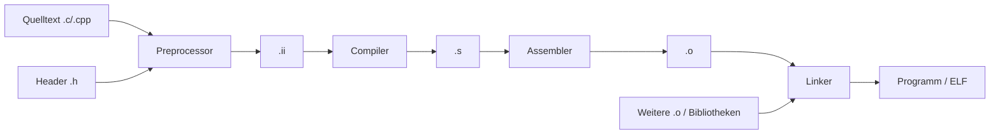
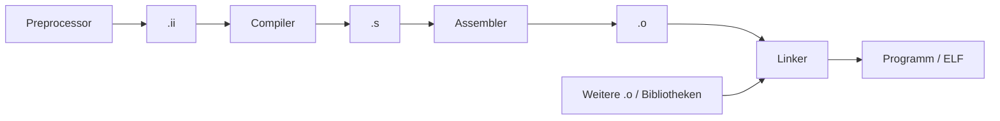
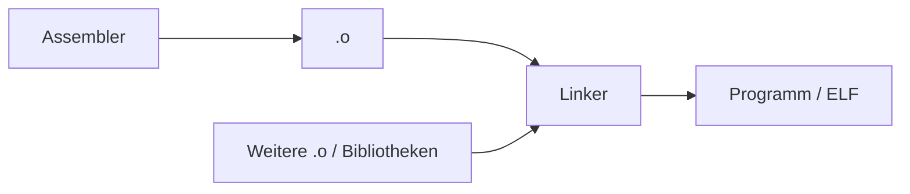
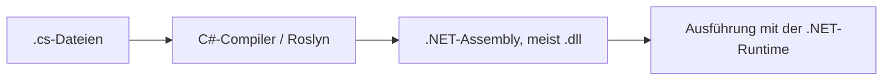
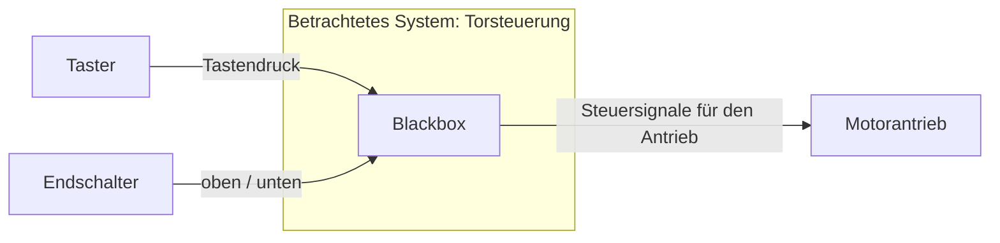
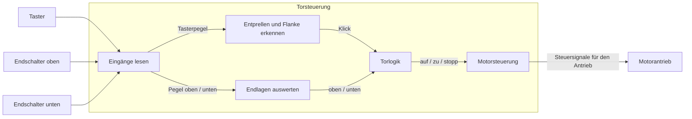

# IoT Workshop

## MB02 · C/C++ Build und Systemdesign

_Fredy Hirt · 17.11.2026_

**Today:** Embedded Systems · C/C++ Build-Pipeline · Top-Down

---

## Previously on...

<div style="font-size: 22px">

- Ihr habt eine Übersicht über das Modul und die Werkzeuge, die wir benutzen
- Ihr kennt den Umfang und Modus des Leistungsnachweises und habt euch in Gruppen organisiert
- Ihr wisst, was im Umgang mit Hardware zu beachten ist
- Ihr seid in der Lage, ein Programm auf eurer Hardware auszuführen
- ~~Ihr kennt den Begriff _Internet of Things_, dessen Herkunft und könnt erläutern, was heute darunter verstanden wird~~

</div>

---

# Today

- Nachtrag: Geschichte des IoT (45 min)
- Embedded Systems (5 min)
- C/C++ Build-Pipleine (20 min)
- Top-Down Systementwurf (20 min)
- C Auftrag & Arbeit am Projekt (90 min)

---

# Ziele

<div style="font-size: 22px">

- Ihr könnt die gundlegenden Eigenschaften von _Embedded Systems_ benennen.
- Ihr kennt den Ablauf der C/C++-Build-Pipeline
- Ihr unterscheidet Build-, Upload- und Laufzeitfehler.
- Ihr identifiziert Subsysteme nach dem Top-Down-Prinzip.

</div>

---

## Embedded Systems

<div style="font-size: 22px">

- Spezialisiertes System aus Hardware und Software für eine bestimmte Aufgabe, häufig in ein technisches Gesamtsystem integriert [1].
- Je nach Anwendung **Echtzeitanforderungen**: Das Ergebnis muss innerhalb einer vorgegebenen Frist vorliegen [1].
- Begrenzte Ressourcen: Rechenleistung, Speicher und Energiebudget.
- Erhöhte Anforderungen an Zuverlässigkeit, Betriebssicherheit und Robustheit [1].
- ca. 98% aller produzierten CPUs werden für Embedded Systems verwendet [2].

</div>

<div class="source">[1] M. Barr, <a href="https://barrgroup.com/introduction-0">«Introduction», <em>Programming Embedded Systems in C and C++</em></a>, Abschnitte «What is an Embedded System?», «Real-Time Systems» und «Variations on the Theme», Barr Group.</div>

<div class="source">[2] M. Barr, <a href="https://barrgroup.com/embedded-systems/glossary">«Embedded Systems Glossary»</a>, Abschnitt «Introduction», Barr Group.</div>

---

# Vom Source-Code zur Firmware

## C/++-Build-Pipeline

---

# Wer macht was?

| Aufgabe | Bekannt aus C# / .NET | In C/C++ |
| --- | --- | --- |
| Code bearbeiten | Visual Studio / VS Code | VS Code |
| Build koordinieren | `dotnet build` / MSBuild | PlatformIO: `pio run` |
| Quelltext übersetzen | C#-Compiler (Roslyn) | C-/C++-Toolchain |
| Ziel konfigurieren | `.csproj`, z. B. Target Framework | `platformio.ini`, z. B. Board |
| Programm bereitstellen | z. B. `dotnet publish`, danach verteilen | Firmware builden und ins Flash laden |

**Der Compiler läuft auf eurem Rechner, die Firmware auf dem ESP32.**

---

# The C/C++ Build Pipeline



Zwischenergebnisse müssen nicht als Dateien gespeichert werden [3].

<div class="source">[3] GCC, «Options Controlling the Kind of Output».</div>

<!-- Vereinfachtes Modell ohne Link-Time-Optimierung. .o enthält Objektcode; .s ist lesbarer Assemblertext. -->

---

# Preprocessor

Quelltext + Header → Präprozessor → `.ii`

<div class="two-columns">
<div>

```cpp
#include <QwiicLedStick.h>
#define BLINK_DELAY_MS 500

static LED leds;
void loop() {
    leds.setLEDColor(255, 0, 0);
    delay(BLINK_DELAY_MS);
    leds.LEDOff();
    delay(BLINK_DELAY_MS);
}
```

</div>
<div style="font-size: 20px; letter-spacing: 0">

- `#include` fügt den Inhalt des Headers ein.
- `#define` ersetzt hier `BLINK_DELAY_MS` durch `500`.
- `#if` / `#ifdef` wählen Quelltext bereits beim Build aus.

</div>
</div>

<!-- Auszug aus blinky-esp32/src/main.cpp; setup() initialisiert Serial, Wire und den LED Stick. QwiicLedStick.h liegt in lib/led/; PlatformIO ergänzt den Include-Suchpfad. Im präprozessierten main.cpp.ii die Klasse LED und delay(500) suchen. Makroersetzung arbeitet auf Tokens. #if ist kein if zur Laufzeit. -->

---

# Header und Implementierung

<div class="two-columns">
<div>

**Blinky: Header und Sourcefile**

```cpp
// QwiicLedStick.h (Auszug)
class LED {
public:
    LED();
private:
    uint8_t _LEDAddress;
};

// QwiicLedStick.cpp: Definition
#include "QwiicLedStick.h"
LED::LED() {
    _LEDAddress = 0;
}
```

</div>
<div>

**C#: eine Datei `LED.cs`**

```csharp
public class LED
{
    private byte ledAddress;

    public LED()
    {
        ledAddress = 0;
    }
}
```

</div>
</div>

---

# Compiler und Assembler



- **Compiler:** prüft Syntax und Typen, optimiert und erzeugt Assemblercode.
- **Assembler:** übersetzt Assemblercode in eine Objektdatei (`.o`).
- Jede `.cpp`-Datei samt Headern bildet eine **Übersetzungseinheit**.
- Externe Funktionsaufrufe können in der Objektdatei noch unaufgelöst sein.

**Objektcode ist noch keine fertige Firmware.**

<!-- Blinky: main.cpp und lib/led/QwiicLedStick.cpp sind getrennte Übersetzungseinheiten. Über QwiicLedStick.h kennt der Compiler die Klasse LED mit Konstruktor und Methoden, aber noch nicht deren Maschinenadressen. Der Header enthält zusätzlich einen Include Guard. -->

---

# Linker



- Verbindet Objektdateien und benötigten Bibliothekscode.
- Löst Verweise auf Funktionen und globale Daten auf.
- Ordnet Code und Daten Speicherbereichen zu.

<!-- Blinky: main.cpp.o verwendet LED::LED(), begin(), setLEDColor() und LEDOff(). QwiicLedStick.cpp.o in libled.a liefert die Definitionen. demo-missing-definition lässt die Bibliothek beim Linken aus; demo-duplicate-definition definiert LED::LED() ein zweites Mal. -->

---

# So kennt ihr es aus C# / .NET

**Quellcode → Build → Programm starten [4]**



- **Beim Build:** Der Compiler prüft den C#-Code und erzeugt eine .NET-Assembly, meist eine `.dll`.
- **Beim Starten:** Die .NET-Runtime lädt das Programm und übernimmt dessen Ausführung auf dem Rechner.
- **Unsere ESP32-Firmware:** Maschinencode entsteht auf dem Entwicklungsrechner. Auf dem ESP32 läuft keine .NET-Runtime.

<div class="source">Weiterführendes: [4] Microsoft, <a href="https://learn.microsoft.com/en-us/dotnet/standard/managed-execution-process">«Managed Execution Process» – JIT (Just-in-Time): Übersetzung in Maschinencode während der Ausführung</a>. [5] Microsoft, <a href="https://learn.microsoft.com/en-us/dotnet/core/deploying/native-aot/">«Native AOT deployment overview» – AOT (Ahead-of-Time): Übersetzung in Maschinencode vor der Ausführung</a>.</div>

---

# Vom Rechner auf den ESP32

**Cross-Compilation:** Auf dem Host bauen, für das Target übersetzen.

<div class="two-columns">
<div>

**`platformio.ini` · Auszug aus Blinky**

```ini
[env:esp32dev]
platform = espressif32
board = esp32dev
framework = arduino
```

Zielplattform, Board und Framework bestimmen die Build-Umgebung.

</div>
<div>

**Ein PC-Programm lässt sich nicht einfach auf den ESP32 kopieren.**

</div>
</div>

---

# Demo · Den Build sichtbar machen

**Vorhersagen → ausführen → Ergebnis erklären**

```sh
pio run -e demo-stages
pio run -e demo-missing-definition
pio run -e esp32dev
```

Unter `.pio/build/demo-stages/src/`: `main.cpp.ii` → `main.cpp.s` → `main.cpp.o`

Was passiert, wenn beim Linken **die LED-Bibliothek fehlt**?

<div class="source">Befehle im Projekt <code>blinky-esp32/</code> ausführen. <code>demo-stages</code> bewahrt mit <code>-save-temps=obj</code> die Zwischenstufen auf [3]. Ablauf: <code>blinky-esp32/docs/build-demo.md</code>.</div>

<!-- Erst erfolgreichen Build und Zwischenstufen zeigen, dann die fehlende Definition vorhersagen lassen. demo-missing-definition ignoriert die Bibliothek led; -Ilib/led hält den Header sichtbar. Anschliessend mit esp32dev den erfolgreichen Normalfall zeigen. Weitere Fehlerumgebungen auf der nächsten Folie. -->

---

# Fehler der richtigen Phase zuordnen

| Demo-Umgebung / Beobachtung | Phase | Erste Prüfung |
| --- | --- | --- |
| `demo-missing-header`: `No such file ...` | Präprozessor | Headername, Suchpfad |
| `demo-compiler-error`: `expected ... ';' ...` | Compiler | Erste Fehlermeldung und Code davor |
| `demo-missing-definition`: `undefined reference` | Linker | Definition vorhanden und mitgelinkt? |
| `demo-duplicate-definition`: `multiple definition` | Linker | Definition mehrfach vorhanden? |
| Keine Verbindung zum Board | Upload | Port, Kabel, Boot-Modus |

<!-- Aufruf jeweils pio run -e <Demo-Umgebung>. Genau einen Fehler pro Build zeigen. Die ersten, zweiten und vierten Varianten aktivieren #if-Abschnitte in src/demo_faults.cpp; die dritte verwendet lib_ignore bei weiterhin sichtbarem Header. Für den Uploadfehler USB abziehen und pio run -e esp32dev -t upload ausführen. -->

---

# Top-down-Systemdesign

## Vom Use-Case zu Modulen

---

# Vom Ganzen ins Detail

**Ziel → Anforderungen → Systemteile → Schnittstellen → Umsetzung**

- Zuerst klären: **Welches Problem lösen wir für wen?**
- Systemgrenze und beobachtbares Verhalten beschreiben.
- Aufgaben schrittweise in überschaubare Teile zerlegen.
- Ergebnisse mit Szenarien prüfen und den Entwurf verfeinern.

**Top-down gibt die Denkrichtung vor. Rückkopplung gehört dazu [7].**

<div class="source">[7] NASA, <em>Systems Engineering Handbook</em>, Kap. 4, insbesondere 4.2–4.4.</div>

<!-- Kein vollständiger Detailentwurf vor dem ersten Experiment nötig. Hardware, Zeit und vorhandene Bibliotheken sind Randbedingungen. Ein Prototyp darf Annahmen widerlegen und den Entwurf verändern. -->

---

# Beispiel · Ein Garagentor steuern

<div style="font-size: 22px; letter-spacing: 0; text-align: left">

«Ich möchte mein Garagentor mit einer einzigen Taste bedienen. Wenn es geschlossen ist, soll es auf Knopfdruck aufgehen. Ist es offen, soll dieselbe Taste es wieder schliessen. Während es fährt, möchte ich es mit einem weiteren Druck anhalten können. Drücke ich danach nochmals, soll es in die andere Richtung fahren. Ganz oben und ganz unten gibt es jeweils einen Endschalter. Dort soll das Tor automatisch anhalten.»

</div>

---

# Aus Wünschen werden Anforderungen

**Anforderungen aus dem Garagentorauftrag**

| ID | Prüfbare Anforderung |
| --- | --- |
| A1 | Nach dem Start ist die Position unbekannt. Der erste Tastendruck startet das Schliessen. |
| A2 | Ein Tastendruck bei geschlossenem Tor startet das Öffnen, bei offenem Tor das Schliessen. |
| A3 | Ein Tastendruck während der Fahrt stoppt den Motor. |
| A4 | Ein Tastendruck nach einem Stopp startet die Gegenrichtung zur letzten Fahrt. |
| A5 | Der jeweilige Endschalter erkennt die Endlage und beendet die Fahrt. |

---

# Systemgrenze · Erst die Blackbox



**Was kommt hinein, was geht hinaus, wer ist ausserhalb?**

<div class="source">Taster, Endschalter und Motorantrieb liegen ausserhalb der betrachteten Steuerung.</div>

---

# Whitebox · Die Steuerung im Detail



**Aus elektrischen Pegeln werden Ereignisse und schliesslich Motorbefehle.**

---

# Whitebox · Wer weiss was?

| Baustein | Verantwortung | Übergabe |
| --- | --- | --- |
| GPIO-Eingänge | Taster, Endschalter oben und unten einlesen | Drei getrennte Pegel |
| Entprellung und Flanke | Prellen filtern, neuen Tastendruck erkennen | Ein Klickereignis |
| Endlagenauswertung | Oben bedeutet offen, unten bedeutet geschlossen | offen / geschlossen |
| Torlogik | Eingänge, Zustand und letzte Richtung auswerten | auf / zu / stopp |
| Motorsteuerung | AUF und ZU gegenseitig verriegeln, GPIOs setzen | Steuersignale für den Antrieb |

---

# Whitebox · Einen Ablauf verfolgen

**Ausgangslage: Das Tor ist geschlossen. Eine Person drückt die Taste.**

1. **GPIO und Entprellung:** lesen den Taster, filtern Prellen und melden einen Klick.
2. **Torlogik:** erkennt «geschlossen + Klick», wählt «auf» und merkt «öffnend».
3. **Motorsteuerung:** hält ZU inaktiv und aktiviert den AUF-Ausgang.
4. **Endlagenauswertung:** erkennt später über den GPIO-Eingang «oben erreicht».
5. **Torlogik und Motorsteuerung:** wechseln zu «offen» und deaktivieren die Fahrbefehle.

**Während der Fahrt werden die Eingänge weiterhin ausgewertet.**

---

# Schnittstellen sind Vereinbarungen

**Beispiel: Eingangserfassung → Torlogik**

| Frage | Unser Beispielvertrag |
| --- | --- |
| Welche Daten? | Klickereignis, Endlage oben, Endlage unten |
| Welche Bedeutung? | Ein Klick wird genau einmal verarbeitet. Eine Endlage ist ein anhaltendes Signal. |
| Wann auswerten? | In jedem Steuerungsdurchlauf, auch während der Fahrt |
| Was bleibt zu klären? | Priorität bei gleichzeitigem Klick und Endsignal |
| Wer macht was? | Erfassung liefert Eingänge. Torlogik entscheidet und merkt die Fahrtrichtung. |

**Ein Funktionsname allein beschreibt noch keinen vollständigen Vertrag.**

<!-- Input 2, 21–29 min: Schnittstellenvertrag erläutern und gemeinsam konkretisieren. Ein gedrückt gehaltener Taster darf nicht bei jedem Durchlauf einen neuen Klick auslösen. Im bereitgestellten Code hasBeenClicked() lesen und das Ereignis mit clearEventBits() quittieren. Der Simulator liefert Endlagen über MotorStatus statt über zwei physische Schalter. Gemeinsam zusätzlich den Vertrag Torlogik → Motorsteuerung formulieren: Befehle, gegenseitiger Ausschluss der Richtungen und Verhalten bei Stopp. Konfliktprioritäten als offenen Entscheid festhalten. -->

---

# Den Entwurf mit Szenarien prüfen

**Testfälle aus unseren Beispielanforderungen ableiten**

| Eingang / Situation | Erwartung | Bezug |
| --- | --- | --- |
| Startposition unbekannt, dann Klick | Motor fährt zu | A1 |
| Geschlossen, Klick, Endlage oben erreicht | Motor fährt auf, dann Stopp | A2 / A5 |
| Offen, Klick, Endlage unten erreicht | Motor fährt zu, dann Stopp | A2 / A5 |
| Klick während des Öffnens, später erneut Klick | Stopp, danach schliessen | A3 / A4 |
| Klick während des Schliessens, später erneut Klick | Stopp, danach öffnen | A3 / A4 |

**Die Reihenfolge der Ereignisse gehört zum Testfall.**

<!-- Input 2, 29–34 min: Szenarien auf dem Papier durch alle Bausteine verfolgen. Beide Fahrtrichtungen prüfen. Ein einzelner Klick hat je nach Vorgeschichte eine andere Wirkung. Endlagensignale müssen auch ohne neuen Tastendruck ausgewertet werden. Für gleichzeitigen Klick und Endsignal zuerst die Priorität festlegen, danach die Erwartung des Tests formulieren. -->

---

# Arbeit am Projekt

## IoT Workshop

---

# Arbeit am Projekt

- Euer System als gemäss [Ausgangslage](https://github.com/HF-IT-A-B-24H-28H/.github-private/blob/main/ausgangslage.md) als Blackbox betrachten.

---

# Quellen · Embedded Systems und C-Build

<div class="source">

[1] M. Barr, “Introduction,” *Programming Embedded Systems in C and C++*, ch. 1, Barr Group. Accessed: Nov. 16, 2026. [Online]. Available: https://barrgroup.com/introduction-0

[2] M. Barr, “Embedded Systems Glossary,” sec. “Introduction,” Barr Group. Accessed: Nov. 16, 2026. [Online]. Available: https://barrgroup.com/embedded-systems/glossary

[3] Free Software Foundation, “Options Controlling the Kind of Output,” *Using the GNU Compiler Collection (GCC)*, sec. 3.2. Accessed: Nov. 16, 2026. [Online]. Available: https://gcc.gnu.org/onlinedocs/gcc/Overall-Options.html

Zum Vertiefen: GNU CPP, *Header Files*. https://gcc.gnu.org/onlinedocs/cpp/Header-Files.html

</div>

---

# Quellen · .NET und Build-Werkzeuge

<div class="source">

[4] Microsoft, “Managed Execution Process,” *Microsoft Learn*. Accessed: Nov. 16, 2026. [Online]. Available: https://learn.microsoft.com/en-us/dotnet/standard/managed-execution-process

[5] Microsoft, “Native AOT deployment overview,” *Microsoft Learn*. Accessed: Nov. 16, 2026. [Online]. Available: https://learn.microsoft.com/en-us/dotnet/core/deploying/native-aot/

[6] PlatformIO, “pio run,” *PlatformIO Documentation*. Accessed: Nov. 16, 2026. [Online]. Available: https://docs.platformio.org/en/latest/core/userguide/cmd_run.html

</div>

---

# Quellen · Systemdesign

<div class="source">

[7] NASA, “4.0 System Design Processes,” *NASA Systems Engineering Handbook*, secs. 4.2–4.4, Jul. 26, 2023. Accessed: Nov. 16, 2026. [Online]. Available: https://www.nasa.gov/reference/4-0-system-design-processes/

Blackbox und Whitebox sind eigene didaktische Darstellungen. Die Build-Demo verwendet das Workshop-Projekt `blinky-esp32` mit einer Blinkpause von 500 ms.

</div>
